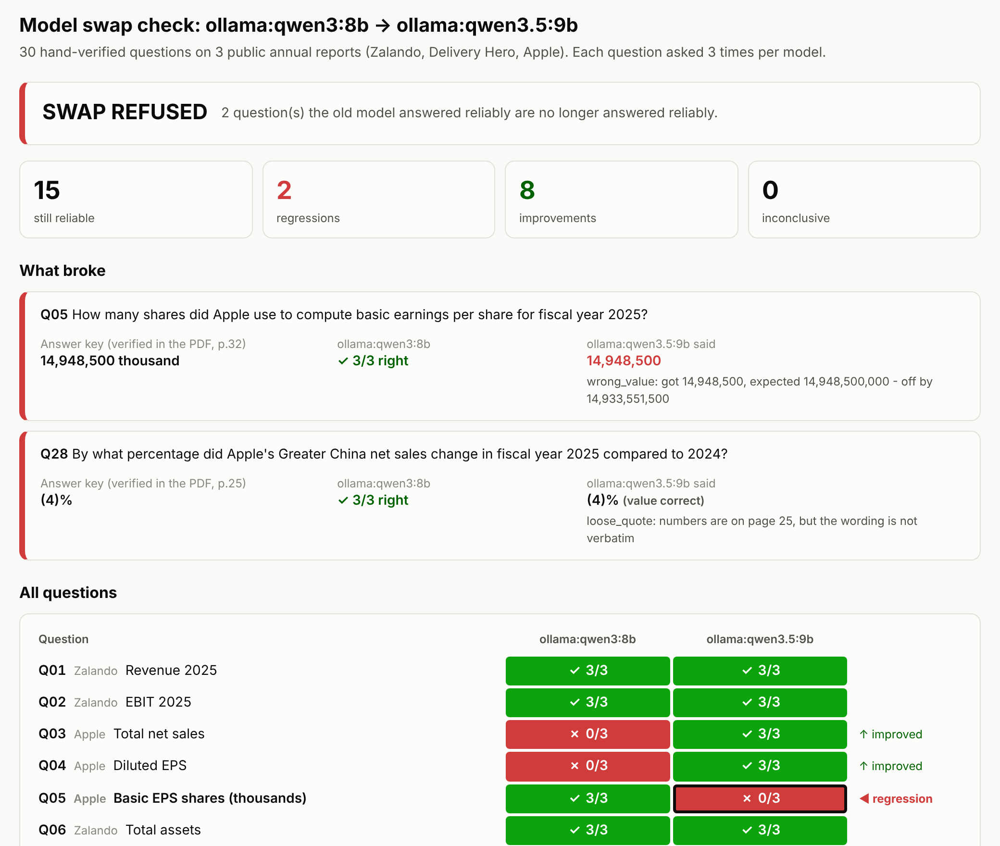

# swapgate

**A regression gate for model swaps in document-extraction workflows.**
It answers one question before you switch the model behind a workflow:
*does the new model still get right everything the old one reliably got right?*
If not, it refuses the swap - exit code 1, not a warning.



## The problem

Model-agnostic platforms make swapping models easy. Langdock's changelog
(checked 5 Nov 2026) added about ten models in two months, most of them
*"auto-enabled where a previous model was active"*. A workflow that extracts
figures from documents keeps returning confident, well-formatted answers after a
swap - nothing crashes, so nobody re-checks.

Averages hide it. The newer model below is **better overall** and still breaks
something the old one did every time.

## The result

`qwen3:8b` → `qwen3.5:9b` (local, via Ollama), 30 questions × 3 attempts each:

| | |
|---|---|
| still reliable | 15 |
| improvements | **8** |
| regressions | **2** |
| decision | **SWAP REFUSED** (exit code 1) |

- **Q05 - Apple, shares used for basic EPS.** The answer key is *14,948,500 thousand*:
  the table header says *"In millions, except number of shares, which are reflected
  in thousands"*. qwen3:8b got it right 3/3. qwen3.5:9b answered **14,948,500** 3/3 -
  **1,000× too small**, with no warning sign anywhere in the output.
- **Q28 - Apple, Greater China sales change.** Value correct, but 1 of 3 answers
  cited a paraphrased quote instead of the page text. Minor - and the report says so.

Full report: [`report.html`](report.html)

## How it works

```
3 annual reports (PDF) ──► text per page ──► 30 hand-verified questions (answer key)
                                                     │
       same 5 pages per question for every model ◄───┘  (BM25 retrieval)
                                                     │
          model ──► JSON {raw_value, unit, source_quote, page} ──► grader ──► runs.db
                                                                                 │
                                                       gate: old vs new ◄────────┘
```

1. **Corpus** - Zalando AR 2025, Delivery Hero AR 2025, Apple 10-K FY2025. Public, so
   anyone can check. 689 pages, extracted per page; SHA-256 of each PDF in
   `corpus/manifest.json`.
2. **Answer key** - 30 questions, 10 per report: money, percentages, percentage points,
   counts, per-share figures, negatives written three ways (`-`, `−`, `(4)`), two text
   answers, and deliberate traps (average vs year-end headcount, IFRS vs segment revenue,
   thousands vs millions). **Every answer was checked by hand against the PDF page**;
   `verify.py` refuses the key if any quote isn't on its page, plus a blind spot-check.
3. **Runner** - every question 3 times per model, every raw reply stored.
4. **Grader** - turns `"3.81bn"`, `"EUR 3,810 million"`, `"3.810,2 Mio. €"` into one typed
   value and compares with precision-aware tolerance. Then checks the quote is really on
   the cited page.
5. **Gate** - see below.

### Key decisions

- **The model copies the number; the code converts it.** Never let the model do the
  arithmetic you're grading - scale errors hide exactly there.
- **No model as a judge.** Grading is deterministic, so the grader can't drift when a
  model changes. 55 tests.
- **No fuzzy matching.** `3,180` vs `3,810` is 90% string-similar and completely wrong.
- **Strict units.** A dropped currency is a failure: a workflow receiving
  `416,161 millions` can't know if it's dollars or euros.
- **Same pages for every model.** A difference in answers is the model's doing, not the
  retrieval's. With 5 pages, the answer's number is on a shown page for 30/30 questions.
- **Three attempts.** `reliable` = 3/3, `unreliable` = sometimes, `fails` = 0/3.
  A question that went from reliable to unreliable *is* a regression.
- **A server error is never a regression.** Timeouts and HTTP 503s are recorded as
  `error`; the gate says *inconclusive - re-run*, never *refused*.
- **Citations have three outcomes:** verbatim (`pass`), right numbers but reworded
  (`loose_quote`), numbers not on the page (`bad_citation` - invented evidence).
- **The gate refuses to compare** runs graded against different answer keys.

## What broke (selection - full log in [`WHAT_BROKE.md`](WHAT_BROKE.md))

- **Hyphens read as minus signs.** `"non-current assets EUR 1,234 million"` was parsed as
  **−1,234**. 28/28 tests were green; none contained a hyphenated word.
- **Two different minus signs in one report.** Delivery Hero prints `–` (en dash) on p.85
  and `−` (minus) on p.166. A correct model citation looked fabricated until the
  citation check treated all dashes as one.
- **The "always correct" fake model scored 27/30.** It cited pages it was never shown -
  exactly what a model answering from memory would do. The check was right; the fake was
  wrong.
- **The answer key accepted a duplicate.** Each entry was checked on its own; nothing
  compared entries with each other. Caught by reading the output, then made a rule.
- **The cloud model was too busy to take the exam.** Gemini free tier: a timeout, then
  HTTP 503 "high demand". That's why server errors can't count as regressions - and why
  the live demo runs on local models.
- **Two page numbers on every page.** Apple's footer prints "10-K | 4" on PDF page 7; a
  model cited 4. Left unfixed on purpose: changing the prompt between the two models'
  runs would change the workflow under test.

## Run it

Requires macOS/Linux, [uv](https://docs.astral.sh/uv/) and [Ollama](https://ollama.com).

```bash
uv sync
# put the three PDFs in corpus/ (names in corpus/manifest.json), then:
uv run python extract.py          # PDF -> text per page, reconciled
uv run python verify.py           # check the answer key against the pages

ollama pull qwen3:8b && ollama pull qwen3.5:9b
uv run python run.py --models ollama:qwen3:8b
uv run python run.py --models ollama:qwen3.5:9b

uv run python gate.py swap ollama:qwen3:8b ollama:qwen3.5:9b    # exit 0 / 1 / 2
uv run python report.py ollama:qwen3:8b ollama:qwen3.5:9b       # grid + report.html
uv run pytest -q                                               # 55 tests
```

No model available? `uv run python run.py --models fake-old,fake-new` runs two scripted
models: `fake-old` must score 30/30 (a pipeline check), `fake-new` breaks 5 planted things.

Gemini works too (`gemini:<model>`, key in a git-ignored `.env`), and any
OpenAI-compatible endpoint - including Langdock's Completion API - is one small adapter
in `models.py`.

## Limits

- 30 questions on 3 documents is a demo-sized answer key, not a benchmark.
- Local 8-9B models, chosen so the whole thing runs for free and offline.
- Retrieval is keyword-based (BM25); answers are always on a shown page, but not always
  on the official statement page.
- Printed page numbers in footers can still confuse a model's citation (see above).

## What I'd build at Langdock

A **Tests** tab next to the compliance rules in Governance: the agent owner uploads
question/answer pairs once; every new agent version - **and every model change** - runs
them before it goes live, and a regression blocks it the way a failed compliance rule
does today. Plus **explicit waivers**: an admin can accept a specific regression with a
written reason, logged for audit.

---
Built by Adit Adit with Claude. Every answer in the answer key was verified by hand.
